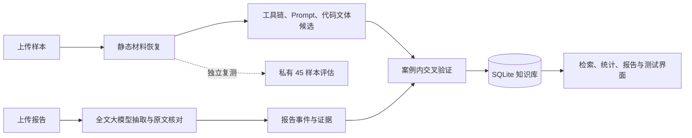

# AI Signal Project 项目交接（DeepSeek Harness）

交接日期：2026-10-14。本文以本机仓库、当前工作分支和已有复测产物为准；若接手时分支或数据发生变化，先重新核验，不沿用本文数字作为新版本结论。

## 🧭 一页交接结论

项目从设计之初就是统一的本地分析平台：对恶意样本做**纯静态** AI 信号提取，对对应报告做大模型信息抽取，保留两条独立证据链，再进行交叉验证、知识库关联、统计和报告生成。统一入口为 FastAPI，Streamlit 仅作本地测试界面。当前版本号为 `0.8.0`。

- 仓库：[yanghanyu521/ai-signal-project](https://github.com/yanghanyu521/ai-signal-project)；本机路径：`D:\长安通讯\AI驱动的攻击手段检测\Ai信号提取项目`。
- 当前分支：`feat/v0.8-dual-path-stylometry`；本次交接核验的 HEAD：`1944e81d6842302df8ce440b60257d8519a622e0`。该分支**尚未合并 `main`**；接手工作继续在此分支增量开展，未经用户要求不要直接合并。
- 源码、两个原项目的组件代码、规则/Schema、结构化种子、API/UI、测试和评估工具已在同一仓库；日常运行不依赖同级旧项目目录。但 GitHub 仓库**不包含**完整原始恶意样本、原始报告、运行数据库或最新逐样本私有评估结果。
- 最新 45 样本 v0.8 私有复测均完成模型流程，质量审计没有发现结构/证据定位错误；**尚无人工裁决金标准，不能声称工具链或 Prompt 准确率、完整召回率已经提高**。
- 最优先工作是受控移交原始数据和私有评估目录、完成双人标注与漏检复核，再据实计算分组指标和决定下一轮改进；不要把候选数量当正确数量。

## 🏗️ 系统与职责边界



样本侧 v0.8 采用源码分析与二进制/封装文件静态字符串分析双路径，保留 AI 工具链、Prompt、AI 生成代码文体指纹三类特征。候选发现、AI 语义确认和静态调用验证是不同等级；二进制中发现字符串不能等同于确认调用。v0.8 默认路径**不调用 JADX/Ghidra，也不执行样本**；旧 Docker 静态恢复脚本仅作历史能力保留。代码文体和近邻检索不输出未经校准的生成模型身份。

报告侧新上传报告默认由大模型直接抽取，并做全文复核、原文证据定位；不再用规则或关键词片段先筛选。交叉验证使用 `supports / contradicts / complements / inconclusive` 保存单独结果，不覆盖样本或报告原始记录。相关设计见[架构与数据流](02_系统架构与数据流.md)、[报告抽取说明](07_报告纯大模型抽取说明.md)、[v0.8 双路径说明](23_v0.8双路径与文体指纹整改说明.md)。

| 目录/文件 | 接手时的用途与边界 |
|---|---|
| [`src/aisig/`](../src/aisig/) 与 [`components/ai_signal_demo/`](../components/ai_signal_demo/) | 样本静态分析器、材料恢复、规则、Schema 与 LLM 路径。 |
| [`src/report_extractor/`](../src/report_extractor/) 与 [`components/report_extractor/`](../components/report_extractor/) | 报告原文解析、模型抽取与证据校验。 |
| [`src/ai_signal_hub/`](../src/ai_signal_hub/) | FastAPI、SQLite 知识库、联合案例、交叉验证、关联检索、统计与报告。 |
| [`ui/`](../ui/) | Streamlit 本地测试界面；不是已加固的生产部署。 |
| [`components/seed_data/`](../components/seed_data/) | 可入库的历史结构化种子；不是 45 个原始文件及报告原文。 |
| [`evaluation/gold_standard/`](../evaluation/gold_standard/) | 公开的标注契约、双人裁决、漏检扫描和评估脚本；不存私有候选原文。 |
| [`tests/`](../tests/) 与 [`evaluation/run_eval.py`](../evaluation/run_eval.py) | 回归测试和 A–K 无害合成评估；不代替真实样本人工金标准。 |

## 🔐 数据、密钥和运行边界

| 数据 | 当前本机位置 | 随 Git 提交？ | 注意 |
|---|---|---|---|
| 完整原始 45 样本 | `D:\长安通讯\AI驱动的攻击手段检测\恶意样本文件` | 否 | 私有 manifest 的样本路径指向此目录；移机后要安全转移并重新映射路径、逐一核对 SHA-256。绝不可执行、双击或交给解释器。 |
| 原始报告及附件 | `D:\长安通讯\AI驱动的攻击手段检测\恶意样本报告` | 否 | 结构化种子不能代替原报告进行重新抽取。 |
| 最新 45 样本评估 | `data/evaluations/20261012_v08_remediation_c13de21/` | 否 | 含未脱敏证据、逐样本 JSON、候选池和漏检队列；只在受控存储中移交。 |
| 本地知识库与上传内容 | `data/knowledge.db`、`data/quarantine/`、`data/reports/` | 否 | 当前库和 v0.8 私有复测是两套状态；评估脚本未自动回写知识库。更新前先备份并核对导入语义。 |
| 历史结构化知识种子 | `components/seed_data/` | 是 | 可在新环境初始化，但不等于最新 v0.8 逐样本结果。 |

`data/` 和 `.env` 已被 Git 忽略。不要将原始恶意样本、未脱敏证据、人工标注值、数据库或真实 API Key 提交到公开仓库，也不要为了方便复现把私有目录移进受版本控制的路径。环境变量使用 `DEEPSEEK_API_KEY`，兼容已有的 `cc-api`；样本侧可用 `SAMPLE_LLM_API_KEY` 单独覆盖，密钥不得写入配置文件或日志。

样本侧模型功能虽可启用，但远端外发默认被 `SAMPLE_LLM_ALLOW_REMOTE=false`、`SAMPLE_LLM_TRANSFER_POLICY=local_only` 禁止；仅在得到相应数据外发授权后，才同时设置允许远端及 `remote_redacted` 或 `remote_full`。报告抽取使用 DeepSeek 配置。每样本不设置总 Token 预算，但有单请求上下文、最多请求数（默认 128）及超时上限；触发限制可能产生 `partial`。配置以[`.env.example`](../.env.example)和[README 安全提示](../README.md#安全提示)为准。API 默认监听 `127.0.0.1`；对外部署前仍缺认证、权限、TLS、审计和独立隔离环境。

## ▶️ 本地启动与只读验收

在项目根目录的 PowerShell 中运行；新环境先使用 Python 3.11 或 3.12 建虚拟环境并安装依赖。

```powershell
python -m venv .venv
.\.venv\Scripts\python.exe -m pip install -e '.[dev]'
.\.venv\Scripts\python.exe -m pytest -q
.\.venv\Scripts\python.exe -m evaluation.run_eval
.\scripts\start_api.ps1
```

另开终端执行 `.\scripts\start_ui.ps1`。API 文档为 `http://127.0.0.1:8000/docs`。常用接口：`POST /api/v1/samples/analyze`、`POST /api/v1/reports/analyze`、`POST /api/v1/analysis-cases`、`POST /api/v1/analysis-cases/{case_id}/cross-validate`、`GET /api/v1/knowledge/search`、`GET /api/v1/statistics/overview`、`POST /api/v1/generated-reports`。完整行为见[README](../README.md)和[API 清单](03_API接口清单.md)。

上面测试不会代替 45 样本真实评估。首次导入知识种子需显式调用 `POST /api/v1/knowledge/import-legacy`；这会写入数据库，**不要在现有库上当作只读验收步骤**。重复运行 45 样本会调用远端模型、消耗额度并产生可能不一致的新结果；先确认数据授权和复测目标。

本次交接核验中，当前工作分支的完整 `pytest -q` 回归通过；A–K 合成评估返回 11 个案例且无失败。这只能证明现有自动测试通过，不构成 45 个真实样本的准确率验收。

## 📊 最新进展与证据强度

完整数字、方法和限制以[2026-10-12 v0.8 整改与评估报告](25_v08整改与45样本评估_20261012.md)为准。最新批次按相同 SHA-256 比较 v0.7 规则、v0.7 完整 LLM、整改前 v0.8 与整改后 v0.8，脚本 23、PE/APK 等二进制/封装 19、其他/未确认 3，共 45 个样本；这四组都有结果文件。

| 状态 | 已核验内容 | 不能推出的结论 |
|---|---|---|
| 流程与定位 | 整改后 45/45 主 LLM 运行状态为 `completed`；质量审计问题数 0，408/408 条 LLM 事实能在保存材料中精确定位。 | 不证明事实的 AI 语义或调用关系正确，也不证明材料被完整扫描。 |
| 覆盖 | 二进制字符串发现 1,801,472 条，保留并进入分析 442,266 条；归档成员发现 5,952、考虑并恢复 884。 | 有大量受限丢弃的字符串和成员，不能宣称无漏检。 |
| 候选与人工标注 | 已生成 606 条去重工具链/Prompt 候选、涉及 37 个 SHA；独立漏检队列抽样 6,592 条。 | 候选池尚未双人标注与裁决；正确数、Precision、Recall、F1 仍未知。漏检扫描 `complete=false`。 |
| 文体 | 源码指纹覆盖 22/45；同进程确定性重复 19/19，`ast.unparse` 后规范化结构一致 16/16。 | 不等于跨平台鲁棒性，不具备生成模型来源真值，不能计算模型身份识别准确率。 |
| 开销 | 整改后主提取 239 次模型请求，提供方报告 16,129,146 Token；另有文体请求 27 次、510,711 Token。 | 请求数或特征候选数增加不是准确率提升。 |

复测为受控断点续跑，不是在最终提交上一次性重跑 45 个模型调用；一处 ZIP 内 PE 材料恢复的最后细化只核对了材料 ID/哈希一致，未重新消费模型请求。模型响应本身也有非确定性。最新私有批次的 `run_metadata.json` 标记 `knowledge_base_modified=false`。本地知识库中显示的历史分析结果或态势数字，不能直接当成最新 v0.8 复测结论；种子看板的“全球 25 个事件、其中 9 个可分析事件”等是项目维护口径，不是实时全球事实。有关统计口径见[统计与逻辑审计](14_统计口径关键特征展示与逻辑审计_20260905.md)。

## 🧪 接手后的优先工作与验收标准

1. **先确认资产与基线。**检查当前分支、提交、工作区、私有目录和 manifest；在受控环境核对 45 个原始 SHA-256 与四版结果。若缺原始样本或私有结果，列出缺件并停止相应准确率结论，不补造数据。
2. **完成人工金标准。**按[标注指南](../evaluation/gold_standard/README.md)对 606 条候选双人独立标注，区分工具链/Prompt 真假、Prompt 角色、已知/未知模型及静态调用；第三人裁决冲突，`uncertain` 单列。模型可辅助排队，不能替代人工核查原始证据。
3. **审查独立漏检区域。**复核 6,592 条抽样队列并扩展到未覆盖字符串/源码区域。当前约 1,427,417 个未命中区域、另有 1,729,083 条字符串未进入漏检检查，完整性仍为 `false`；只有覆盖审计签发完成后才可报告完整 Recall，否则明确标注“候选池 Recall/F1”。
4. **按材料组分析误差。**分别报告脚本与 PE/APK 等二进制、家族、已知/未知模型、静态调用升级的 Precision/Recall/F1 与误判案例；文体单独评估重复性、LLM 标签、格式化鲁棒性及近邻检索。不要把“同家族近邻”解释为“生成模型归因”。
5. **再做有依据的增量改进。**优先解决人工证实的高影响误判/漏检，尤其是二进制字符串/归档上限、无调用关系的有效 Prompt 与错误调用升级；新增回归测试。若要把新结果写入知识库，先设计版本化迁移、备份与对照验收，避免覆盖人工修订。

验收底线：每项指标都能追溯到原始 SHA、材料位置、人工裁决和评估脚本；报告分清“已验证”“待人工复核”“无法验证”。保留[金标准工具](../evaluation/gold_standard/)、[45 样本复测脚本](../scripts/run_v08_remediation_45.py)和私有批次的原始输出，不在公开 Git 中泄露证据。已有历史报告可能记录旧版本状态，判断当前 v0.8 以本文、[最新评估报告](25_v08整改与45样本评估_20261012.md)及代码/私有产物现场核验为准。

## ⚠️ 给 DeepSeek Harness 的执行约束

- 从当前分支做增量修改，不重写项目，不擅自合并 `main`、强推或提交私有数据。代码变更应有独立提交、回归测试和可复现的评估记录。
- 只做静态分析，不运行真实恶意样本；不要把 v0.8 的 JADX/Ghidra 描述为当前默认链路。任何样本材料送远端模型前，核对外发策略和授权。
- 先区分“源码/结构化种子已在仓库”与“原始样本、报告、数据库和逐样本评估只在本机私有路径”。若移至新主机，没有安全移交这些资产就无法复现 45 样本实测。
- 对新发现特征坚持“候选存在 → 语义确认 → 静态调用验证”的证据等级，不凭模型自述把 `model_argument` 或孤立字符串升级；不要输出没有真值支撑的生成模型身份结论。
